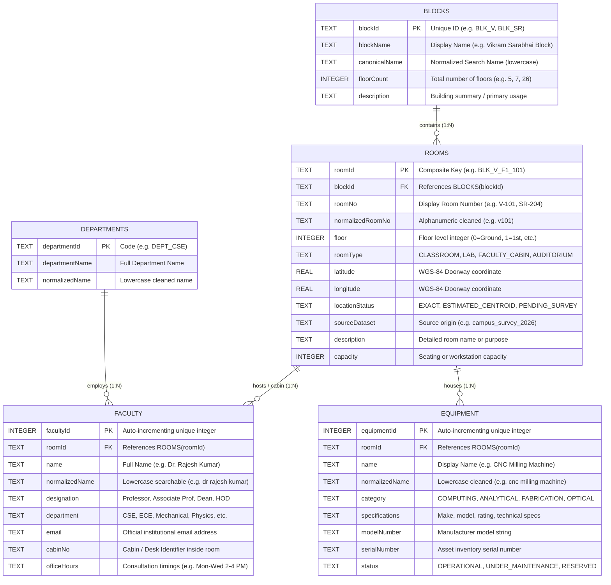

# SRM AP Campus Navigator — Database Structure & Schema Specification

**Document Version:** 1.1.0  
**Target Platform:** Android (SQLite via Room 2.6+ / SQLite FTS5)  
**Scope:** Structural schema, table definitions, column types, relationships, constraints, and JSON/CSV ingestion formats for **Blocks**, **Rooms**, **Faculty**, **Equipment**, and **Departments**.

---

## 1. Relational Entity Relationship (ER) Diagram



---

## 2. Table Specifications & Required Columns

### 2.1 `blocks` (Building & Wing Master)
Defines all physical academic and residential structures on the SRM University–AP campus.

| Column Name | SQL Type | Constraint | Required? | Description & Examples |
| :--- | :--- | :--- | :---: | :--- |
| `blockId` | `TEXT` | `PRIMARY KEY` | **Yes** | Unique identifier (e.g., `BLK_V`, `BLK_H`, `BLK_SR`, `BLK_GANGA`, `BLK_VEDAVATHI`). |
| `blockName` | `TEXT` | `NOT NULL` | **Yes** | Official name (e.g., `"Vikram Sarabhai Block"`, `"SR Block"`, `"Ganga Boys' Hostel"`). |
| `canonicalName`| `TEXT` | `NOT NULL` | **Yes** | Lowercase normalized search string (e.g., `"vikram sarabhai block"`). |
| `floorCount` | `INTEGER` | `NOT NULL` | **Yes** | Total number of above-ground levels (e.g., `5`, `7`, `15`, `26`). |
| `description` | `TEXT` | `NULLABLE` | Optional | Overview of block functions (e.g., `"Main Engineering & Computational Sciences Block"`). |

---

### 2.2 `rooms` (Classrooms, Labs, Cabins & Venues)
Defines every specific room, lab, auditorium, or administrative space.

| Column Name | SQL Type | Constraint | Required? | Description & Examples |
| :--- | :--- | :--- | :---: | :--- |
| `roomId` | `TEXT` | `PRIMARY KEY` | **Yes** | Globally unique room ID (e.g., `BLK_V_F1_101`, `BLK_SR_F3_305`). |
| `blockId` | `TEXT` | `FOREIGN KEY` | **Yes** | References `blocks(blockId)` ON DELETE CASCADE. |
| `roomNo` | `TEXT` | `NOT NULL` | **Yes** | Official signage display label (e.g., `"V-101"`, `"SR-305"`, `"AL-201"`). |
| `normalizedRoomNo` | `TEXT` | `NOT NULL` | **Yes** | Cleaned alphanumeric token for instant FTS matching (e.g., `"v101"`, `"sr305"`). |
| `floor` | `INTEGER` | `NOT NULL` | **Yes** | Floor index (`0` = Ground, `1` = 1st Floor, `2` = 2nd Floor, etc.). |
| `roomType` | `TEXT` | `NOT NULL` | **Yes** | Category: `CLASSROOM`, `LAB`, `FACULTY_CABIN`, `AUDITORIUM`, `SEMINAR_HALL`, `OFFICE`. |
| `latitude` | `REAL` | `NULLABLE` | Recommended | Latitude of room entrance door (e.g., `16.464952`). |
| `longitude` | `REAL` | `NULLABLE` | Recommended | Longitude of room entrance door (e.g., `80.507612`). |
| `locationStatus` | `TEXT` | `NOT NULL` | **Yes** | Coordinates precision: `EXACT`, `ESTIMATED_CENTROID`, `PENDING_SURVEY`. |
| `sourceDataset` | `TEXT` | `NULLABLE` | Optional | Audit tracking string (e.g., `"srmap_academic_audit_v2"`). |
| `description` | `TEXT` | `NULLABLE` | Recommended | Descriptive label (e.g., `"High Performance Computing Lab"`). |
| `capacity` | `INTEGER` | `NULLABLE` | Optional | Seating / occupancy capacity (e.g., `60`, `120`). |

---

### 2.3 `faculty` (Professors, Staff & Office Directory)
Associates professors and academic staff directly with their office rooms or cabins for instant room-level navigation.

| Column Name | SQL Type | Constraint | Required? | Description & Examples |
| :--- | :--- | :--- | :---: | :--- |
| `facultyId` | `INTEGER` | `PRIMARY KEY AUTOINCREMENT` | **Yes** | Unique integer identifier. |
| `roomId` | `TEXT` | `FOREIGN KEY` | **Yes** | References `rooms(roomId)` ON DELETE CASCADE. Points to cabin location. |
| `name` | `TEXT` | `NOT NULL` | **Yes** | Official full name (e.g., `"Dr. K. Murali"`, `"Prof. S. R. Rao"`). |
| `normalizedName` | `TEXT` | `NOT NULL` | **Yes** | Lowercase normalized string for search without titles (e.g., `"murali k"`). |
| `designation` | `TEXT` | `NULLABLE` | Recommended | Academic rank (e.g., `"Professor & Head"`, `"Associate Professor"`, `"Dean"`). |
| `department` | `TEXT` | `NULLABLE` | **Yes** | Department acronym or name (e.g., `"Computer Science & Engineering"`). |
| `email` | `TEXT` | `NULLABLE` | Recommended | SRM AP official email (e.g., `"murali.k@srmap.edu.in"`). |
| `cabinNo` | `TEXT` | `NULLABLE` | Optional | Specific desk or workstation inside a shared room (e.g., `"Desk 4"`, `"Cabin A"`). |
| `officeHours` | `TEXT` | `NULLABLE` | Optional | Student consultation timings (e.g., `"Mon, Wed 14:00 - 16:00"`). |

---

### 2.4 `equipment` (Laboratory Devices, Machinery & Research Assets)
Associates scientific apparatus, computing clusters, and workshop machinery with specific research laboratories.

| Column Name | SQL Type | Constraint | Required? | Description & Examples |
| :--- | :--- | :--- | :---: | :--- |
| `equipmentId` | `INTEGER` | `PRIMARY KEY AUTOINCREMENT` | **Yes** | Unique integer identifier. |
| `roomId` | `TEXT` | `FOREIGN KEY` | **Yes** | References `rooms(roomId)` ON DELETE CASCADE. Points to lab where housed. |
| `name` | `TEXT` | `NOT NULL` | **Yes** | Official equipment name (e.g., `"Scanning Electron Microscope (SEM)"`, `"3D Printer"`). |
| `normalizedName`| `TEXT` | `NOT NULL` | **Yes** | Lowercase searchable name and common synonyms (e.g., `"sem electron microscope"`). |
| `category` | `TEXT` | `NULLABLE` | Recommended | Domain: `MICROSCOPY`, `SPECTROSCOPY`, `FABRICATION`, `ROBOTICS`, `COMPUTING`. |
| `specifications`| `TEXT` | `NULLABLE` | Recommended | Technical capabilities (e.g., `"Resolution: 1.2nm, Accelerating Voltage: 30kV"`). |
| `modelNumber` | `TEXT` | `NULLABLE` | Optional | Hardware model identifier (e.g., `"ZEISS EVO 18"`). |
| `serialNumber`| `TEXT` | `NULLABLE` | Optional | Institutional inventory barcode / serial ID. |
| `status` | `TEXT` | `NULLABLE` | Optional | Operational state: `OPERATIONAL`, `UNDER_MAINTENANCE`, `RESTRICTED`. |

---

### 2.5 `departments` (Academic Units Master)

| Column Name | SQL Type | Constraint | Required? | Description & Examples |
| :--- | :--- | :--- | :---: | :--- |
| `departmentId` | `TEXT` | `PRIMARY KEY` | **Yes** | Identifier (e.g., `DEPT_CSE`, `DEPT_ECE`, `DEPT_MECH`, `DEPT_PHY`). |
| `departmentName`| `TEXT` | `NOT NULL` | **Yes** | Full title (e.g., `"Department of Computer Science and Engineering"`). |
| `normalizedName`| `TEXT` | `NOT NULL` | **Yes** | Cleaned search string (e.g., `"computer science and engineering cse"`). |

---

## 3. SQLite DDL Implementation (Android Room Schema)

```sql
-- 1. BLOCKS TABLE
CREATE TABLE IF NOT EXISTS blocks (
    blockId TEXT PRIMARY KEY NOT NULL,
    blockName TEXT NOT NULL,
    canonicalName TEXT NOT NULL,
    floorCount INTEGER NOT NULL,
    description TEXT
);

-- 2. ROOMS TABLE
CREATE TABLE IF NOT EXISTS rooms (
    roomId TEXT PRIMARY KEY NOT NULL,
    blockId TEXT NOT NULL,
    roomNo TEXT NOT NULL,
    normalizedRoomNo TEXT NOT NULL,
    floor INTEGER NOT NULL,
    roomType TEXT NOT NULL,
    latitude REAL,
    longitude REAL,
    locationStatus TEXT NOT NULL DEFAULT 'EXACT',
    sourceDataset TEXT,
    description TEXT,
    capacity INTEGER,
    FOREIGN KEY(blockId) REFERENCES blocks(blockId) ON DELETE CASCADE
);

CREATE INDEX IF NOT EXISTS index_rooms_blockId ON rooms(blockId);
CREATE INDEX IF NOT EXISTS index_rooms_normalizedRoomNo ON rooms(normalizedRoomNo);
CREATE INDEX IF NOT EXISTS index_rooms_floor ON rooms(floor);

-- 3. FACULTY TABLE
CREATE TABLE IF NOT EXISTS faculty (
    facultyId INTEGER PRIMARY KEY AUTOINCREMENT NOT NULL,
    roomId TEXT NOT NULL,
    name TEXT NOT NULL,
    normalizedName TEXT NOT NULL,
    designation TEXT,
    department TEXT,
    email TEXT,
    cabinNo TEXT,
    officeHours TEXT,
    FOREIGN KEY(roomId) REFERENCES rooms(roomId) ON DELETE CASCADE
);

CREATE INDEX IF NOT EXISTS index_faculty_roomId ON faculty(roomId);
CREATE INDEX IF NOT EXISTS index_faculty_normalizedName ON faculty(normalizedName);

-- 4. EQUIPMENT TABLE
CREATE TABLE IF NOT EXISTS equipment (
    equipmentId INTEGER PRIMARY KEY AUTOINCREMENT NOT NULL,
    roomId TEXT NOT NULL,
    name TEXT NOT NULL,
    normalizedName TEXT NOT NULL,
    category TEXT,
    specifications TEXT,
    modelNumber TEXT,
    serialNumber TEXT,
    status TEXT DEFAULT 'OPERATIONAL',
    FOREIGN KEY(roomId) REFERENCES rooms(roomId) ON DELETE CASCADE
);

CREATE INDEX IF NOT EXISTS index_equipment_roomId ON equipment(roomId);
CREATE INDEX IF NOT EXISTS index_equipment_normalizedName ON equipment(normalizedName);

-- 5. DEPARTMENTS TABLE
CREATE TABLE IF NOT EXISTS departments (
    departmentId TEXT PRIMARY KEY NOT NULL,
    departmentName TEXT NOT NULL,
    normalizedName TEXT NOT NULL
);
```

---

## 4. Ingestion Templates (JSON & CSV)

### 4.1 Faculty Ingestion Sample (`faculty_data.json`)
```json
[
  {
    "name": "Dr. Ashok Kumar",
    "roomId": "BLK_V_F2_204",
    "designation": "Associate Professor",
    "department": "Computer Science & Engineering",
    "email": "ashok.k@srmap.edu.in",
    "cabinNo": "Cabin 3",
    "officeHours": "Mon, Wed 10:00 - 12:00"
  },
  {
    "name": "Dr. Sunita Sharma",
    "roomId": "BLK_SR_F4_412",
    "designation": "Professor & Dean",
    "department": "Electronics & Communication Engineering",
    "email": "sunita.s@srmap.edu.in",
    "cabinNo": "Executive Suite B",
    "officeHours": "Tue, Thu 14:00 - 16:00"
  }
]
```

### 4.2 Equipment Ingestion Sample (`equipment_data.json`)
```json
[
  {
    "name": "High-Resolution Transmission Electron Microscope (TEM)",
    "roomId": "BLK_V_F0_015",
    "category": "MICROSCOPY",
    "specifications": "Field Emission Gun, 200kV accelerating voltage, 0.1nm point resolution",
    "modelNumber": "JEOL JEM-2100F",
    "status": "OPERATIONAL"
  },
  {
    "name": "Universal Testing Machine (UTM)",
    "roomId": "BLK_SR_F1_102",
    "category": "FABRICATION",
    "specifications": "Tensile and compressive testing up to 100kN load capacity",
    "modelNumber": "Instron 5982",
    "status": "OPERATIONAL"
  }
]
```

### 4.3 Room Ingestion Sample (`rooms_data.json`)
```json
[
  {
    "roomId": "BLK_V_F2_204",
    "blockId": "BLK_V",
    "roomNo": "V-204",
    "floor": 2,
    "roomType": "FACULTY_CABIN",
    "latitude": 16.464952,
    "longitude": 80.507612,
    "locationStatus": "EXACT",
    "description": "CSE Faculty Cabins Suite 2",
    "capacity": 8
  },
  {
    "roomId": "BLK_V_F0_015",
    "blockId": "BLK_V",
    "roomNo": "V-015",
    "floor": 0,
    "roomType": "LAB",
    "latitude": 16.464780,
    "longitude": 80.507420,
    "locationStatus": "EXACT",
    "description": "Advanced Materials Characterization Lab",
    "capacity": 25
  }
]
```
